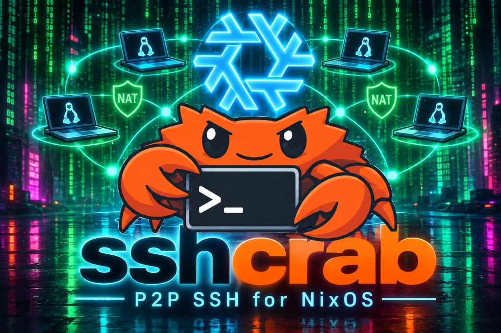

# sshcrab

A remote shell like `ssh`, over SCTP/UDP, whose sessions survive disconnects: close the laptop, change networks,
come back with `sshcrab -R` and the shell is where you left it. With the P2P backend, a server behind NAT or
without any open port is reachable by its address `<key>.p2p` through a DHT.

The design and the security analysis are in [SPECIFICATION.md](SPECIFICATION.md); the P2P background is in
[P2P.md](P2P.md).

| Program | Runs on | Purpose |
|---|---|---|
| `sshcrab` | your machine | client |
| `sshcrab-keygen-ed25519` | your machine | creates your key |
| `sshcrabd` | server, as root | the daemon; never links the P2P code |
| `sshcrabd-p2p` | server, unprivileged and sandboxed | announces the server in the DHT and passes connections to `sshcrabd` |
| `sshcrab-dht-node` | optional, a public host | a DHT bootstrap node, for a private DHT or as an extra entry point |

> [!WARNING]
> **Prototype code. Not hardened, not reviewed; do not expose it to untrusted networks.** This holds for both
> ways in: direct SCTP/UDP and the P2P backend. Before it is fit for that it needs at least:
>
> - **Both paths:** privilege separation. Today `sshcrabd` parses network input as root; the planned split
>   into a root monitor and a sandboxed network worker is not done (SPECIFICATION.md §7.4). Also fuzzing, a
>   constant-time login path (user names can be told apart by timing) and an external review of the handshake.
> - **P2P:** peeroxide (DHT, hole punching, its encryption) is young and unaudited; several denial-of-service
>   issues were fixed upstream only in 1.8.0 and 1.8.2 (section 7). There is no relay for symmetric NATs.
>
> Our own encryption layer (Noise + Ed25519, the same on both paths) is the part reviewed most so far. Use sshcrab
> next to OpenSSH, never as the only way into a machine.



### Video

Why sshcrab is interesting and how it was developed:

[](https://www.youtube.com/watch?v=qdHQDtGOvbQ)

## How it works

### Sessions outlive connections

A session (a shell or a command) belongs to `sshcrabd`, not to a connection. The daemon keeps it running when the
client goes away, until it ends or has been unattached for `DisconnectedTimeout` (24 h by default). Sessions live in
the daemon's memory only, so a daemon restart ends them.

- **Byte offsets on both directions.** Every chunk of input and output carries its offset in the stream and is
  acknowledged by the other side at the application level. After a reconnect each side resends from where the
  other acknowledged, so nothing is lost or duplicated, whichever transport the old and new connection used.
- **Output buffer on the server.** Unacknowledged output waits in a per-session buffer. A command blocks when it is
  full (no data loss); an interactive shell drops the oldest output and the client is told how much.
- **Resuming** (`sshcrab -R`): the client picks a session and continues it; one that is attached elsewhere can be
  taken over. A shell gets its last 64 KiB of output replayed, a full-screen program (htop, vim) is made to
  repaint at the new window size, and the terminal modes it had set (alternate screen, mouse, …) are restored.
- **Liveness.** The client pings every 2 s over the encrypted channel and says so after 5 s without an answer; a
  connection silent for 15 s is dead. The session survives that, and an interactive client reconnects on
  its own.

### Two ways to reach a server

```
direct:   sshcrab ── SCTP over UDP (port 22 by default) ─────────────────────────────────► sshcrabd (root)

P2P:      sshcrab ── DHT lookup + hole punch ──► sshcrabd-p2p ── socketpair (fd passing) ──► sshcrabd (root)
          our protocol inside peeroxide's        unprivileged, sandboxed;      over /run/sshcrab/p2p.sock
          encrypted stream (UDX over UDP)        relays, never decrypts
```

- **Direct:** the server's UDP port must be reachable.
- **P2P:** the server announces itself in a DHT (HyperDHT, through [peeroxide](https://crates.io/crates/peeroxide))
  under a key derived from its host key; its address is that key, `<52 characters>.p2p`. The client looks the
  address up, both sides punch a hole through their NATs, and the connection is direct, without any port forward
  or open firewall. All P2P code runs in the separate `sshcrabd-p2p` helper; the root daemon never links it.

### Protocol layers

```
              shell, sessions, Ping/Pong
                        │
   SecureConn: Noise_NN + Ed25519 (host key, user key)
                        │
          ┌─────────────┴─────────────┐
     direct path                  P2P path
          │                         │
         SCTP              SecretStream (peeroxide)
          │                         │
         UDP                  UDX over UDP
```

Our own encryption layer (`SecureConn`) is the same on both paths: host and user authentication, the host-key check
and the session protocol do not depend on the transport below.

### Protocol decisions

| Decision | Why | Details |
|---|---|---|
| **SCTP over UDP** for direct connections, in user space (`sctp-proto`) | Reliable, ordered *message* streams; control and data travel on two separate streams, so lost output does not delay control messages. UDP does not clash with OpenSSH on TCP port 22. QUIC/TLS were considered and rejected. | SPEC §5 |
| **Own keepalive**, retransmission timeout 0.5–4 s | `sctp-proto` never sends heartbeats and never gives up on an association; an authenticated ping also cannot be spoofed. | SPEC §5 |
| **Noise_NN + Ed25519 signatures** over the handshake hash | A standard key agreement instead of an ad-hoc one. The server proves its host key first, so the client never reveals user name or key to an unverified server. New keys on every reconnect (forward secrecy across reconnects). | SPEC §6.1–6.2 |
| **Host keys pinned on first use** (TOFU), also for `.p2p` | Like ssh's `known_hosts`. A `.p2p` address does not replace this check: whoever holds the P2P key (for example after taking over the helper) could present a host key of their own. | SPEC §13.3 |
| **Reliability at the application level too** (offsets and acks) | Transport reliability ends with the connection; sessions must survive reconnects and switches between transports. | SPEC §4.3 |
| **Compression** of server output only, after authentication, per message (pure-Rust `ruzstd`) | No decompressor reachable before login; keystrokes (passwords) are never compressed; no shared context leaking between messages. | SPEC §6.6 |
| **P2P: no SCTP on top of UDX** | Two reliable layers stacked on each other both retransmit and fight each other ("TCP over TCP"). UDX provides retransmission, ordering and congestion control; our messages travel as `stream id ‖ message` frames on one UDX stream. | SPEC §13.1 |
| **P2P: our encryption inside peeroxide's** | peeroxide's own layer is what lets only the holder of the P2P key answer at an address. Ours keeps the host key authenticated end to end, so the helper and DHT nodes never see plaintext. Costs only CPU. | SPEC §13.1, §13.3 |
| **P2P in a separate, unprivileged helper** | The DHT and hole-punching code (young, unaudited) handles internet traffic; it runs sandboxed with no access to the host and hands each connection to `sshcrabd` as a file descriptor. | SPEC §13.4–13.5 |

Trade-offs of the P2P path compared with direct SCTP: control and data share one ordered stream (a lost packet
delays both), and retransmissions follow libudx's timer (minimum 1 s) instead of ours (0.5 s). Measure with
`sshcrab --ping`.

## 1. Your key (client)

```sh
nix profile install github:nixcloud/sshcrab#sshcrab
sshcrab-keygen-ed25519 ~/.sshcrab/id_ed25519
cat ~/.sshcrab/id_ed25519.pub      # goes into the server configuration below
```

## 2. A NixOS server

sshcrab is distributed as a flake, but your server does not have to be one: a classic `configuration.nix` imports
the NixOS module straight from the flake and keeps `nixos-rebuild switch` as it is.

```nix
# /etc/nixos/configuration.nix
{ config, pkgs, ... }:
let
  # Pin a commit: without one, every rebuild may pick up a newer sshcrab.
  sshcrab = builtins.getFlake "github:nixcloud/sshcrab/<commit>";
in
{
  imports = [
    ./hardware-configuration.nix
    sshcrab.nixosModules.default          # adds services.sshcrab
  ];

  # builtins.getFlake needs the flakes feature (your configuration stays a non-flake one).
  nix.settings.experimental-features = [ "nix-command" "flakes" ];

  services.sshcrab = {
    enable = true;
    authorizedKeys.alice = [ "ssh-ed25519 AAAAC3Nza... alice@laptop" ];
    p2p.enable = true;        # reachable through the DHT, also behind NAT
    # openFirewall = true;    # also reachable directly on UDP port 22
  };
}
```

```sh
# The first time, before the setting above is active:
nixos-rebuild switch --option experimental-features 'nix-command flakes'
# From then on, as usual:
nixos-rebuild switch
```

Updating sshcrab means changing `<commit>`. sshcrab is built with the nixpkgs pinned in its own `flake.lock`, not
your system's; only the module's systemd units, users and settings become part of your system. The build files are
generated during evaluation (import from derivation, allowed by default), so the first evaluation takes a while.

**Without the flakes feature at all:** load the flake through
[flake-compat](https://github.com/edolstra/flake-compat), which also follows sshcrab's `flake.lock`:

```nix
let
  sshcrab = (import (fetchTarball {
    url = "https://github.com/edolstra/flake-compat/archive/<rev>.tar.gz";
    sha256 = "<hash>";
  }) {
    src = fetchTarball {
      url = "https://github.com/nixcloud/sshcrab/archive/<commit>.tar.gz";
      sha256 = "<hash>";
    };
  }).defaultNix;
in
{
  imports = [ sshcrab.nixosModules.default ];
  # services.sshcrab = { ... } as above
}
```

**If your server is a flake already:** add the input and the module, or start from the template:

```nix
# flake.nix
inputs.sshcrab.url = "github:nixcloud/sshcrab";
# nixosSystem { modules = [ sshcrab.nixosModules.default ./configuration.nix ]; }
```

```sh
nix flake init -t github:nixcloud/sshcrab#server
nixos-rebuild switch --flake .#myserver     # --target-host root@server for a remote machine
```

Once deployed, get the address:

```sh
sshcrab-p2p-address         # on the server, e.g. kxgpyjz9wb5o…ruwyo.p2p
```

The address belongs to the server's host key (`/var/lib/sshcrab/host_key`): it stays the same across restarts and
redeploys as long as that file is kept. Back it up like an SSH host key.

### Options

| Option | Default | Meaning |
|---|---|---|
| `services.sshcrab.enable` | `false` | run `sshcrabd` |
| `.port` / `.listenAddresses` | `22` / `0.0.0.0`, `[::]` | UDP listen addresses (no clash with OpenSSH, which uses TCP) |
| `.openFirewall` | `false` | open `port` for UDP; not needed for P2P-only access |
| `.authorizedKeys.<user>` | `{ }` | keys per user, root-managed in `/etc/sshcrab/authorized_keys.d/`; users' own `~/.sshcrab/authorized_keys` keep working |
| `.permitRootLogin`, `.allowUsers`, `.allowGroups` | `true`, `[ ]`, `[ ]` | who may log in |
| `.logLevel` | `"info"` | `RUST_LOG` of the daemon and the helper |
| `.settings` | `{ }` | any other `sshcrabd.toml` key (SPECIFICATION.md §3) |
| `.clientPackage` | the client | installed system-wide; `null` = none |
| `.p2p.enable` | `false` | the sandboxed `sshcrabd-p2p` helper and its `sshcrab-p2p` user |
| `.p2p.bootstrap` | built-in list | DHT bootstrap nodes (`host:port`) |
| `.p2p.maxPeers` | `64` | concurrent P2P connections |
| `.dhtNode.enable` | `false` | run a bootstrap node (section 5) |
| `.dhtNode.port`, `.public`, `.bootstrap`, `.openFirewall` | `49737`, `true`, `[ ]`, `true` | its settings |

The helper sees nothing of the host except the daemon's socket: no capabilities, read-only system, no `/home`, no
other processes, its own memory limit. Check with `systemd-analyze security sshcrabd-p2p`.

## 3. Connect

```sh
sshcrab alice@kxgpyjz9wb5o…ruwyo.p2p              # interactive shell
sshcrab alice@kxgpyjz9wb5o…ruwyo.p2p 'uptime'     # one command
sshcrab -R alice@kxgpyjz9wb5o…ruwyo.p2p           # pick a session to resume
sshcrab -L alice@…  /  sshcrab -C alice@…         # list / detach or remove sessions
sshcrab --ping alice@…                            # round trips at typing pace (min/median/p99/max)
sshcrab alice@server.example.org                  # directly over UDP, if openFirewall is set
```

The first connection asks you to trust the host key (or pass `--accept-new`); it is then pinned in
`~/.sshcrab/hostkeys`, and a different key is refused. A P2P connection takes 1–2 s, up to about 40 s when hole
punching is needed. Hole punching fails behind symmetric NATs (some mobile and corporate networks); there is no
relay yet.

Bootstrap nodes for the client: `~/.sshcrab/config.toml`

```toml
P2PBootstrap = ["dht.example.org:49737"]
```

or `--bootstrap HOST:PORT` (repeatable). Without either, the built-in list is used: the public HyperDHT nodes.

## 4. Other Linux distributions (systemd)

Install the binaries with Nix and link the unit files:

```sh
nix profile install --profile /nix/var/nix/profiles/sshcrab \
    github:nixcloud/sshcrab#default github:nixcloud/sshcrab#systemd-units
P=/nix/var/nix/profiles/sshcrab
sudo systemd-sysusers $P/lib/sysusers.d/sshcrab.conf          # creates the sshcrab-p2p user
sudo install -d -m 0700 /var/lib/sshcrab
sudo install -m 0600 $P/share/sshcrab/sshcrabd.toml.example /var/lib/sshcrab/sshcrabd.toml
sudo systemctl link $P/lib/systemd/system/sshcrabd.service $P/lib/systemd/system/sshcrabd-p2p.service
sudo systemctl enable --now sshcrabd.service sshcrabd-p2p.service
cd /var/lib/sshcrab && sudo $P/bin/sshcrabd --p2p-address
```

Keys go into `~<user>/.sshcrab/authorized_keys` (or a root-owned directory set as `AuthorizedKeysDir`). To update,
upgrade the profile and run `systemctl daemon-reload` and restart both services.

For a server that should run NixOS instead, [nixos-anywhere](https://github.com/nix-community/nixos-anywhere)
installs the template configuration over SSH.

## 5. A bootstrap node

Needed only if you do not want to depend on the public HyperDHT nodes. On a host with a static public IPv4:

```nix
services.sshcrab.dhtNode = {
  enable = true;           # UDP 49737, joins the public network (public = true)
  host = "203.0.113.7";    # this host's public IPv4; optional with public = true
};
```

A node's DHT id derives from its public address. Bound to `0.0.0.0` it learns that address from the nodes it
joins, so a first node of a private DHT must bind its public IPv4 (the module refuses otherwise). Then point
clients and servers at it (`p2p.bootstrap`, `P2PBootstrap`). With `public = false` and only your own nodes
in the lists you get a private DHT; run at least three nodes then. To try without installing anything:
`nix run github:nixcloud/sshcrab#sshcrab-dht-node -- --public`.

## 6. Development

```sh
nix develop                          # rustc/cargo 1.99 (nixcloud cargo, nix backend)
cargo build && cargo test
tests/e2e.sh && tests/e2e-p2p.sh     # end to end on 127.0.0.1
nix build .#checks.x86_64-linux.p2p  # NixOS VM test: DHT node, NAT router, server, client
```

`nix/test-keys/alice` is a throwaway key for the VM test, public on purpose. Do not use it anywhere else.

## 7. peeroxide: no patches

sshcrab uses the crates of the [peeroxide](https://crates.io/crates/peeroxide) project (`peeroxide`, `peeroxide-dht`,
`libudx`) unchanged from crates.io, pinned exactly to **1.8.3** in `p2p/Cargo.toml`. Up to 1.7.4 sshcrab carried
patched copies of `libudx` and `peeroxide`; upstream fixed both problems in 1.8.0, and the copies were dropped. The
tests that caught them stay, so an upgrade that brings a problem back fails them.

| Problem in 1.7.4 | Fixed upstream in | Test |
|---|---|---|
| `libudx`: `UdxAsyncStream` allowed one unacknowledged write at a time and `flush` waited for the ACK. SecretStream writes every message as header, body, flush, so each message cost two round trips: about 200 ms per keystroke at a 40 ms ping. | 1.8.0: writes no longer wait for acknowledgements, `flush` returns at once, `shutdown` returns once the end of the stream is acknowledged (the write path now follows C libudx). | `p2p/tests/latency.rs` |
| `peeroxide`: a swarm gave a connection's `max_peers` slot back only when setting it up failed. Every client uses a fresh key, so after 64 connections in total (reconnects included) `sshcrabd-p2p` ignored every new client until restarted; 64 throwaway keys did it on purpose. | 1.8.0 ([GHSA-48wj-x5q3-ggfq](https://github.com/Rightbracket/peeroxide/security/advisories/GHSA-48wj-x5q3-ggfq)) | `p2p/tests/slots.rs` |

1.8.0 also fixed two other denial-of-service issues our review had noted: a lookup reply that could abort the client
([GHSA-4jh8-33j3-h73j](https://github.com/Rightbracket/peeroxide/security/advisories/GHSA-4jh8-33j3-h73j)), and
SecretStream allocating a frame's declared length (up to 16 MiB) before the peer is authenticated
([GHSA-pchg-rmv6-56f4](https://github.com/Rightbracket/peeroxide/security/advisories/GHSA-pchg-rmv6-56f4)).

1.8.2 fixed one we reported: anyone could make a P2P server unreachable by announcing under its key with a key of
their own, as DHT nodes forwarded the server's handshakes to whoever announced last (upstream #69, SPECIFICATION.md
§13.8). Test `p2p/tests/impostors.rs`.

Measured with `p2p/tests/latency.rs` (40 ms round trip): a keystroke's echo takes one round trip (43 ms); 50 small
messages there and back take about two round trips on a fresh stream and one once its congestion window has grown
(1.7.4: 4.4 s).

## License

Public domain ([Unlicense](LICENSE)). Dependencies keep their own licenses.
